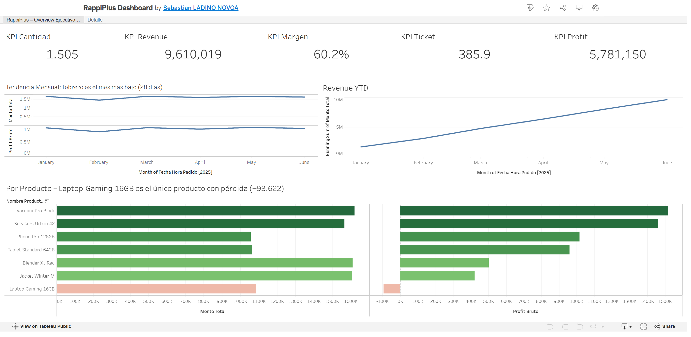
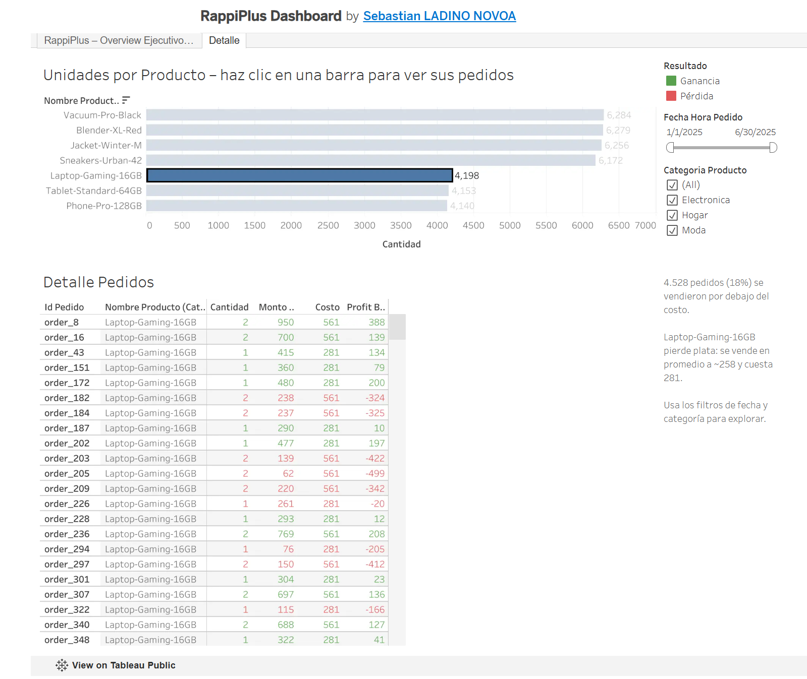

# RappiPlus Subscription Analysis: From Data to Business Decisions

**Live dashboard (Tableau Public):** [View dashboard](https://public.tableau.com/views/RappiPlusDashboard_17916413859700/RappiPlusOverviewEjecutivoenerojunio2025)

## Business context
RappiPlus is a subscription service within Rappi's ecosystem, designed to increase purchase frequency and revenue per user. The business team wasn't sure the service was working. This end-to-end analysis answers six questions, from data quality to an executive dashboard.

> Case study developed as the final project of the TripleTen Data Analytics bootcamp. Data provided by TripleTen for educational purposes.

## Questions answered
1. Can we trust the data? → Data quality (Python)
2. Is the business profitable? → Revenue, cost and profit (Python)
3. Where do users drop off? → Conversion funnel (SQL)
4. Do users come back? → Cohort retention (SQL)
5. Did the checkout change work? → A/B test (Python)
6. How do we communicate it? → Dashboard (Tableau)

## Tools
Python (pandas, statsmodels) · SQL (PostgreSQL: CTEs, window functions, CASE) · Tableau Public · Jupyter

## Key findings
- **Data quality:** 10 orders (0.04%) with 10,000–20,000 units each accounted for ~80% of raw revenue. Without cleaning, revenue would have been overstated ~5x.
- **Profitability:** Revenue 9.61M, product cost 3.83M, marketing 2.87M → profit 2.91M (30% margin). Gross margin is 60%, so marketing consumes about half of it.
- **Loss-making product:** Laptop-Gaming-16GB sells below cost on average (~258 vs. 280.68 unit cost), losing 93.6K. 18% of all orders were sold below cost.
- **Funnel:** 80% of visitors purchase. The biggest drop-off is between begin_checkout and add_payment_info: 958 users lost (86.7% step conversion).
- **Retention:** ~42% of users remain active in weeks 1–3 across all monthly cohorts; most churn happens in the first week.
- **A/B test (new checkout UI):** Control 15.69% vs. treatment 16.29% (+3.8% lift), p = 0.42. Not statistically significant; the test was underpowered for such a small effect (~60K users per group would be needed).

## Recommendations
1. Review Laptop-Gaming-16GB pricing and discounts, and validate its unit cost in the catalog.
2. Reassess marketing spend and test shifting budget toward Paid Search (highest revenue per unit of spend: 3.48).
3. Focus the next experiment on the payment-info step, the largest leak in the funnel.
4. Invest in first-week onboarding to improve early retention.

## Approach
**1. Data cleaning (pandas):** converted dates; dropped 50 orders missing quantity and price (0.2%, MCAR check by country); standardized text ("argentina" → "Argentina"); filled descriptive nulls; removed 100 duplicates, 4 refunds and 10 extreme-quantity outliers; rebuilt 101 missing marketing channels from campaign IDs. Result: 24,906 clean orders.

**2. Profitability:** merged orders with the product catalog (many-to-one, row counts validated) to compute cost and profit per order; segmented by product and channel.

**3. Funnel (SQL):** unique users per event, ordered by the real user flow with CASE; step and overall conversion with LAG and FIRST_VALUE.

**4. Cohorts (SQL):** monthly signup cohorts with DATE_TRUNC; weekly retention with COUNT(DISTINCT CASE WHEN ...).

**5. A/B test:** checked group balance and cross-contamination; two-proportion z-test (alpha = 0.05).

**6. Dashboard (Tableau):** executive overview (KPIs, monthly trend, YTD revenue, profit by product) and a detail view with conditional formatting, filters and click-to-filter drill-through. All figures validated against Python.

## Repository structure
- `rappiplus_analysis.ipynb` — full analysis notebook, Steps 1–5 (commentary in Spanish)
- `Data/` — cleaned datasets (orders, catalog, marketing)
- `overview.png`, `detail.png` — dashboard screenshots

## Author
Sebastián Ladino Novoa — Data Analyst | Trilingual (ES/EN/PT)
[LinkedIn](https://www.linkedin.com/in/sebastianladinonovoa/)
